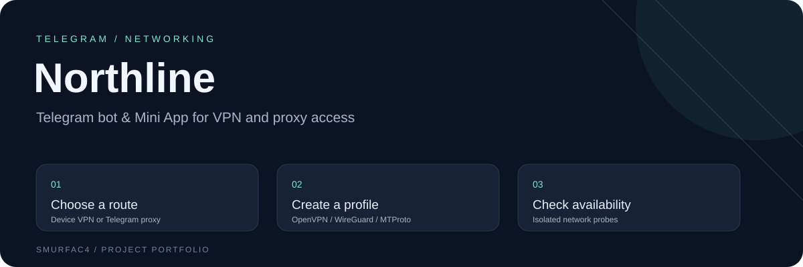

<p align="center"></p>

# Northline · VPN & Telegram Mini App

A Python Telegram bot and Mini App with two separate connection modes: device-wide VPN access and Telegram-only proxy access. The backend manages profiles, server catalogs, availability checks and administration; the web interface guides users through location selection and client setup.

## Connection modes

| Mode | Protocols | Purpose |
| --- | --- | --- |
| Device VPN | Public OpenVPN configurations or a self-hosted WireGuard node | Connect applications and websites through a device VPN client |
| Telegram only | MTProto | Configure a proxy connection inside Telegram |

Profiles have no built-in expiry. Public servers are checked at startup and hourly using an actual VPN tunnel with HTTPS or an MTProto exchange with Telegram. Failed nodes are replaced when a verified alternative is available; unavailable locations are removed from the selection. Availability of third-party servers is not guaranteed.

## Architecture

- `backend/` — API, Mini App, administration, profiles and catalog refresh tasks.
- `bot/` — Telegram messages, menus and launch buttons.
- `deploy/` — network probe images, node setup, packaging and service definitions.
- `tests/` — isolated tests and test fixtures.
- `.env.example` — configuration template without production credentials.

The illustration above is an architecture overview, not a screenshot of a live account.

## Requirements

Use Python 3.9+, a Linux VPS, Docker Engine and a stable HTTPS domain for hosting. Network probes need the required container networking capabilities, including TUN/NET_ADMIN for VPN checks. The backend and bot use the Python standard library; network checks run in separate Docker containers.

## Run from source

```bash
git clone https://github.com/smurfac4/northline-vpn-showcase.git
cd northline-vpn-showcase
cp .env.example .env
chmod 600 .env
```

Fill in `.env` with your own bot token, API key, domain and permitted/admin Telegram IDs. Keep these values private. Build the network probe images from the repository root:

```bash
docker build -t northline-mtproxy:local -f deploy/mtproxy/Dockerfile deploy
docker build -t northline-openvpn-probe:local deploy/device-probe
python3 run.py
```

`run.py` supervises the backend and bot and restarts them after failures. Stop any previous process using the same bot token before starting another instance. The backend binds to `127.0.0.1:8000`; configure Caddy and systemd using the [hosting guide](docs/HOSTING.md). Server discovery may take several minutes.

## Build a hosting archive

```bash
python3 deploy/package.py
```

This creates `dist/northline-hosting.tar.gz`. Extract it into the target user's home directory to create a `northline` folder, configure a private `.env`, and follow the hosting guide. The source bundle excludes instance data and credentials.

When updating an existing installation, preserve its `.env`, database and node registries. Do not overwrite them with files from a new installation.

## Tests

Run the isolated Python test suite from the repository root:

```bash
python3 -m unittest discover -s tests -p 'test_*.py'
```

Tests use fixtures and mocks; a successful test run does not verify a production bot, live VPN tunnels or the availability of external servers.

## Configuration and operational data

`.env`, `data/`, databases, private keys, user profiles and runtime node registries are private instance data. They must not be committed. Public source code uses placeholders and test fixtures instead of production credentials.

## Documentation

The linked operational guides currently remain in Russian; this README is in English.

- [Hosting and scheduled refresh](docs/HOSTING.md)
- [Administration](docs/ADMIN.md)
- [Device VPN](docs/DEVICE_VPN.md)
- [Telegram proxies](docs/FREE_TELEGRAM_PROXIES.md)
- [Permanent access](docs/UNLIMITED_ACCESS.md)

## Public source

This repository publishes the backend, bot, Mini App, deployment tooling and tests as a separate source snapshot. It does not include the operational repository history or production data.
